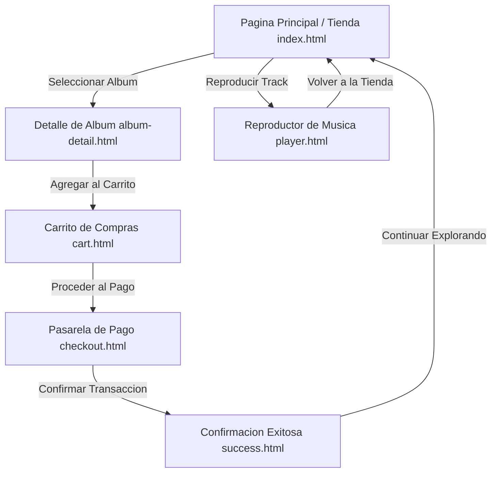

# MusicStream Store - Plataforma de Comercio Electronico y Reproduccion de Musica Digital

Interfaz web moderna y adaptativa para la exploracion de catalogo musical, adquisicion de vinilos de coleccion y reproduccion en linea basada en estandares puros de HTML5 y CSS3.

[]()
[]()
[]()
[]()

## Resumen Ejecutivo

El diseno de plataformas digitales para la industria musical requiere un balance riguroso entre estetica vanguardista, rendimiento optimo y jerarquia visual intuitiva. MusicStream Store ofrece una arquitectura de interfaz limpia que simula la experiencia completa de una tienda de musica: desde el descubrimiento de lanzamientos discograficos, visualizacion de pistas y fichas tecnicas de masterizacion, hasta el flujo de carrito de compras, pasarela de pago y reproductor embebido.

## Alcance y Objetivos de Negocio

- Arquitectura de interfaz orientada a componentes modulares utilizando CSS nativo sin dependencias de frameworks externos.
- Diseno adaptativo (Mobile-First y Desktop) con soporte para altas densidades de pixeles.
- Flujo transaccional completo: Catalogo -> Detalle de Album -> Carrito de Compras -> Checkout -> Confirmacion de Compra.
- Reproductor multimedia estilizado con controles de reproduccion, barra de progreso y lista de canciones.
- Optimizacion estricta de tiempos de carga y compatibilidad semantica accesible.

## Arquitectura del Sistema

El proyecto implementa una arquitectura basada en la metodologia de organizacion modular de estilos y paginas estaticas:
1. Capa de Base y Variables Globales (`css/main.css`).
2. Capa de Estructura y Distribucion de Grid (`css/layout.css`).
3. Capa de Componentes Reutilizables (`css/components.css`).
4. Capa de Vistas Especificas (`css/views/*.css`).
5. Paginas HTML interconectadas mediante hiperenlaces semanticos.

### Diagrama de Flujo Arquitectonico y Navegacion



### Estructura de Directorios

```text
Proyecto-HTML-CSS-C/
├── index.html           # Vista principal de la tienda y catalogo discografico
├── album-detail.html    # Ficha tecnica del album, tracklist y opciones de compra
├── player.html          # Interfaz dedicada del reproductor de audio digital
├── cart.html            # Resumen del carrito de compras y calculo de subtotal
├── checkout.html        # Formulario de direccion de envio y datos de pago
├── success.html         # Pantalla de confirmacion de orden con resumen de compra
├── README.md            # Documentacion tecnica de ingenieria del proyecto
├── assets/              # Recursos multimedia
│   ├── icons/           # Iconografia vectorial y logos de alta resolucion
│   └── img/             # Portadas de albumes y recursos graficos en WebP/AVIF
└── css/                 # Hojas de estilo estructuradas en capas
    ├── main.css         # Reset CSS, variables CSS y tipografias globales
    ├── layout.css       # Sistema de grillas (Header, Sidebar, Main, Footer)
    ├── components.css   # Botones, badges, tarjetas de producto y reproductores
    └── views/           # Reglas especificas por cada vista individual
```

## Stack Tecnologico

Construido exclusivamente con estandares web oficiales del W3C para garantizar rendimiento maximo, mantenibilidad y accesibilidad universal.

### Estandares de Marcado y Estructuracion

-  Estandar semantico oficial (W3C Semantic Elements: header, main, nav, section, article, aside, footer).
-  Atributos accesibles y roles semanticos para tecnologias asistivas.

### Diseno Visual, Tipografia y Maquetacion

-  Sistema de estilos nativo con Custom Properties y selectores avanzados.
-  Distribucion bidimensional para el dashboard de tienda y paneles laterales.
-  Alineacion unidimensional para barras de navegacion, listas de reproduccion y tarjetas.
-  Fuentes tipograficas Inter (lectura fluida) y Space Grotesk (titulares).

### Formatos Multimedia y Optimizacion de Recursos

- **Imagenes AVIF / WebP**: Compresion de ultima generacion reduciendo el peso de transferencia en mas de un 60% frente a JPEG/PNG tradicionales.
- **Google Fonts CDN**: Enlace optimizado con preconeccion anticipada (`rel='preconnect'`).

## Requisitos Previos del Sistema

- Cualquier navegador web con soporte de CSS Grid y CSS Variables:
  - Chrome 60+
  - Firefox 55+
  - Safari 11+
  - Edge 79+
- No se requiere instalacion de Node.js, Python ni compiladores adicionales para su visualizacion basica.

### Sistema de Variables de Diseno (Tokens CSS)

El archivo `css/main.css` define los tokens centrales del sistema de diseno:

```css
:root {
  --color-bg-primary: #0a0b0e;
  --color-bg-surface: #14161d;
  --color-accent: #6366f1;
  --color-accent-hover: #4f46e5;
  --color-text-main: #f8fafc;
  --color-text-muted: #94a3b8;
  --font-family-sans: 'Inter', system-ui, sans-serif;
  --font-family-display: 'Space Grotesk', sans-serif;
  --border-radius-base: 12px;
  --transition-smooth: all 0.25s cubic-bezier(0.4, 0, 0.2, 1);
}
```

## Guia de Instalacion y Despliegue Local

1. Clonar el repositorio en su estacion de trabajo:
```bash
git clone https://github.com/SantiSarmiento11/Proyecto-HTML-CSS-C.git
cd Proyecto-HTML-CSS-C
```

2. Abrir directamente en su navegador web o servir mediante un servidor HTTP local.

### Comprobacion de Archivos y Recursos Estaticos

Verificar que las carpetas de recursos y estilos esten intactas:
```bash
# Listado de componentes CSS
ls -l css/
# Listado de imagenes multimedia
ls -l assets/img/
```

### Ejecucion en Servidor de Desarrollo Local

Para emular el comportamiento de un servidor web en produccion:
```bash
# Opcion 1: Servidor ligero con Python
python -m http.server 8080

# Opcion 2: Extension Live Server de VS Code (Clic derecho en index.html -> 'Open with Live Server')
```

Acceso inmediato en el navegador: `http://localhost:8080`
